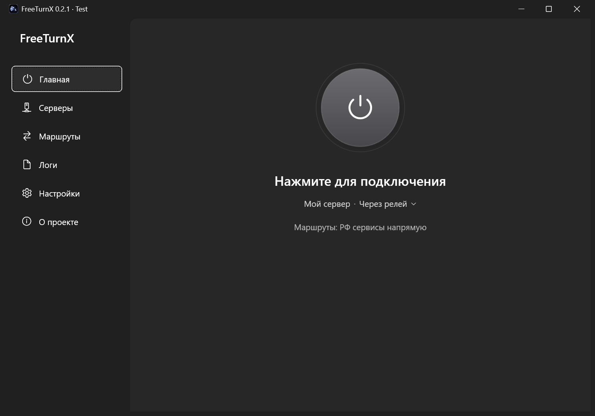
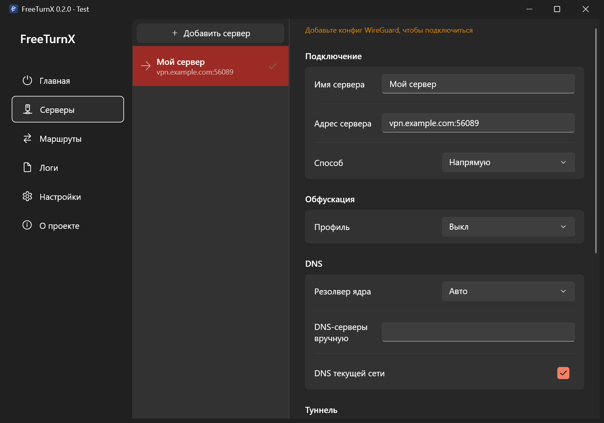
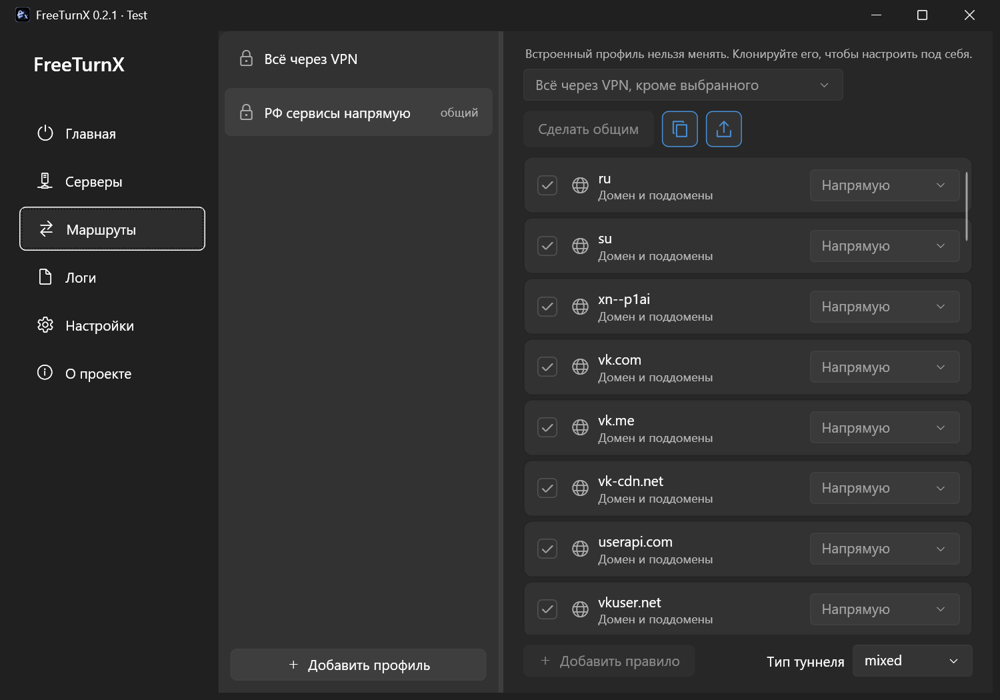
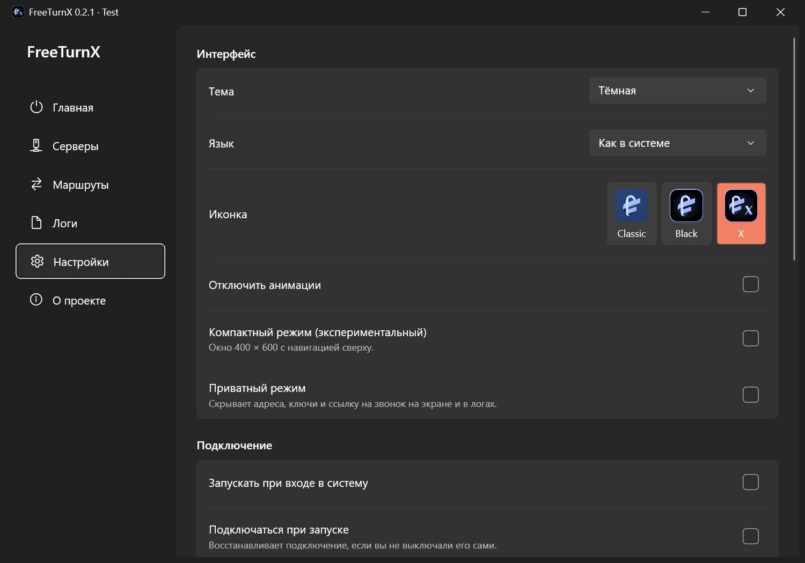
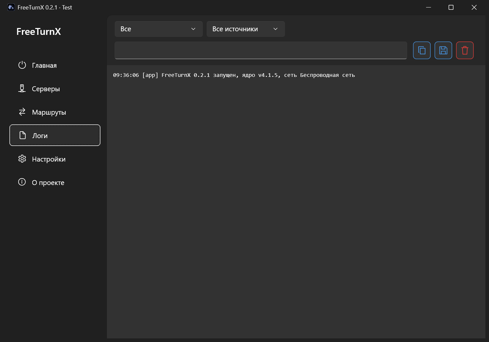
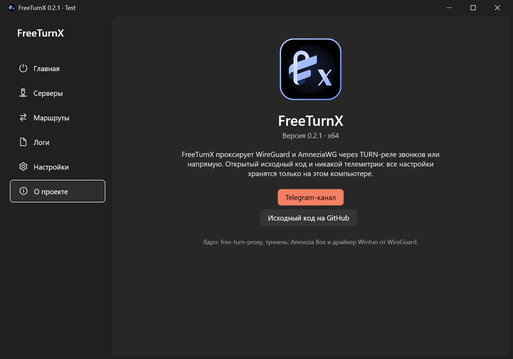

# FreeTurnX для Windows

Нативный клиент [free-turn-proxy](https://github.com/hackdiaz-dev/free-turn-proxy) для Windows 10 и 11: системный VPN
(WireGuard / AmneziaWG) через TURN-реле звонка или напрямую, с маршрутизацией по программам, доменам и подсетям.
Тот же функционал, что у [клиента для macOS](https://github.com/huhhuh78787878-collab/freeturn-macos).

Новости и обновления - в [Telegram-канале](https://t.me/+ZVdbpZB0w_Q1MTdi).

## Скриншоты

Версия 0.2.0, демонстрационные данные.

| Главная | Серверы |
|---|---|
|  |  |

| Маршруты | Настройки |
|---|---|
|  |  |

| Логи | О проекте |
|---|---|
|  |  |

## Возможности клиента

- Подключение через релей (по ссылке на звонок) или напрямую — как в Android-клиенте.
- Несколько серверов: добавить, клонировать, переименовать, удалить, выбрать активный.
- Импорт `freeturn://`: клик по ссылке в браузере или мессенджере, вставка из буфера, QR из файла, из буфера или со снимка экрана, ручная настройка.
- Маршруты: «всё через VPN, кроме…» или «только выбранное через VPN»; правила по программам (`.exe` или целая папка), доменам, ключевым словам и подсетям; действия «через VPN», «напрямую», «блокировать»; импорт и экспорт профилей; встроенный профиль «РФ сервисы напрямую».
- Капча: автоматическая в фоне или ручная — в отдельном окне поверх остальных (закрывается само) либо в браузере.
- Скорость, трафик, время сессии, потоки, пинг; логи с фильтрами и файлом на диске; приватный режим.
- Значок в области уведомлений с цветом состояния, запуск при входе, автоподключение, смена сети и пробуждение без ручных действий.
- Три варианта иконки: Classic, Black (OLED) и X.
- Автообновление из GitHub Releases под процессор компьютера.

## Установка

1. Скачайте установщик со [страницы релизов](https://github.com/huhhuh78787878-collab/freeturn-win/releases/latest):
   - `FreeTurnX-…-x64-setup.exe` — обычные компьютеры на Intel и AMD;
   - `FreeTurnX-…-arm64-setup.exe` — компьютеры на ARM (Snapdragon).
2. Запустите и подтвердите запрос администратора. SmartScreen может предупредить: «Подробнее» → «Выполнить в любом случае» — установщик не подписан сертификатом.
3. Установщик ставит приложение, службу туннеля и, если её нет, среду WebView2 (для окна капчи).

Требуется Windows 10 версии 1809 или новее.

## Устройство

| Процесс | Права | Что делает |
|---|---|---|
| `FreeTurnX.exe` | пользователь | интерфейс, хранение, сборка конфигов |
| `freeturn-core.exe` | пользователь | ядро free-turn-proxy без правок; сокеты привязаны к физической сети (`IP_UNICAST_IF`), мимо туннеля |
| `freeturnd.exe` | служба Windows (LocalSystem) | запускает движок Amnezia Box: адаптер туннеля, маршруты, правила |

Адаптер туннеля — **wintun**, официальный подписанный драйвер проекта WireGuard; он встроен в движок, свои драйверы не нужны.
Закрыли приложение или оно упало — служба снимает туннель сама. Данные: `%LOCALAPPDATA%\FreeTurn`.

## Ограничения

- Нет режима локального порта и TCP-режима для Xray.
- Значок самого `.exe` в Проводнике всегда стандартный; выбранная иконка применяется к окну, трею и пользовательскому ярлыку в меню «Пуск». Закреплённый ранее ярлык может потребовать повторного закрепления.
- Служба останавливает движок принудительно (у службы нет консоли для мягкого сигнала).
- Установщик без подписи Authenticode.

## Лицензия

GPL-3.0.
